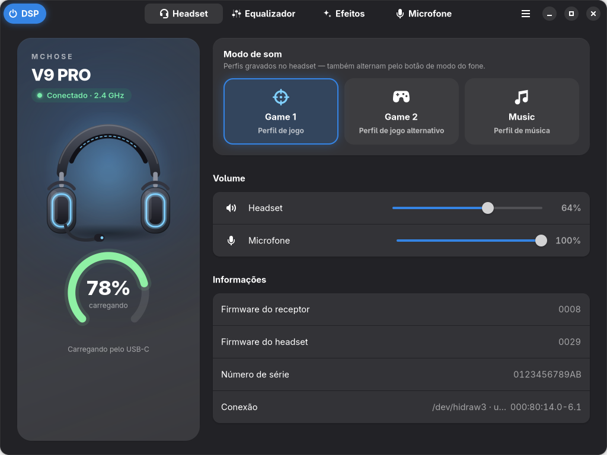
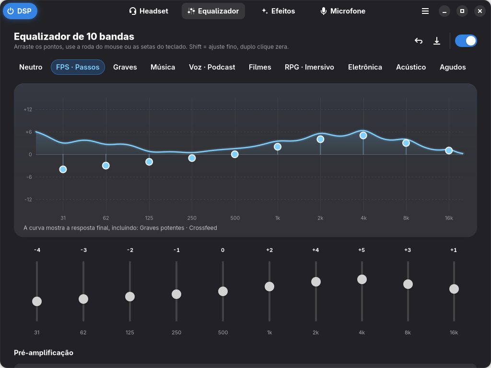
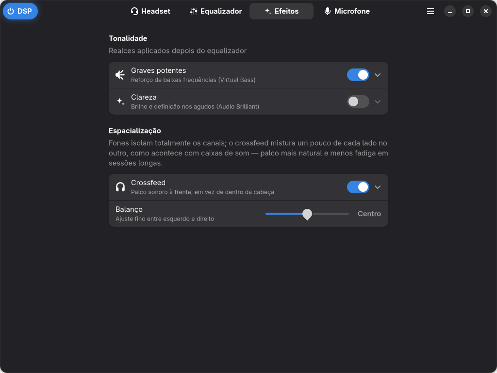
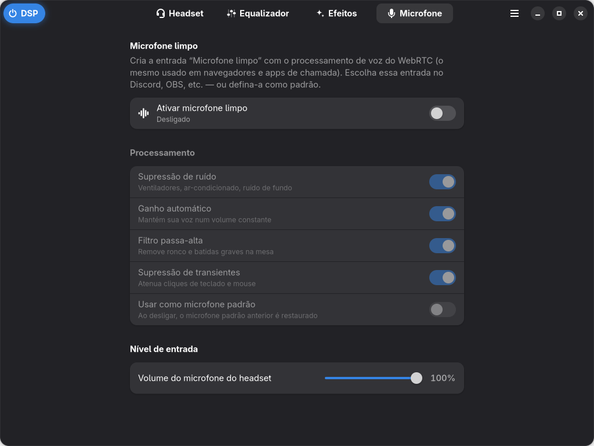
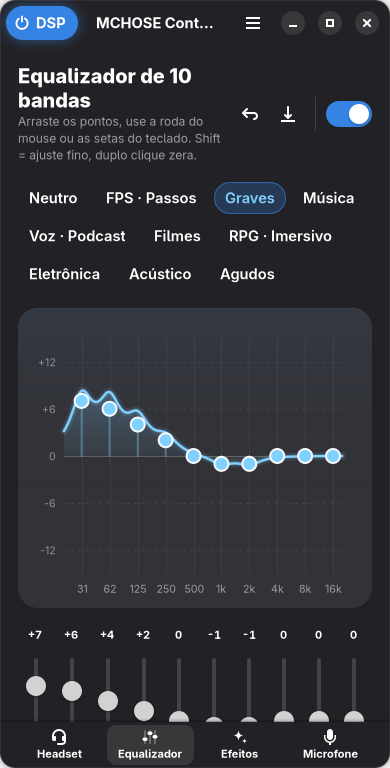

# MCHOSE Control

Software para Linux, em Rust, que faz o papel do **MCHOSE HUB** (que só existe para Windows)
nos headsets MCHOSE com receptor C-Media 2.4 GHz: **V9 PRO**, V9, G9 PRO e S9 PRO
(USB `291d:385d`).



## O que ele faz

| Recurso | Como funciona |
|---|---|
| 🔋 **Bateria** (nível, carregando, completa, headset em repouso) | protocolo HID do receptor, em tempo real |
| 🎮 **Modo de som** Game 1 / Game 2 / Music | protocolo HID; acompanha o botão físico do headset |
| 🧾 **Firmware** do receptor e do headset | protocolo HID (só leitura) |
| 🎚️ **Equalizador de 10 bandas** + 10 presets + presets salvos por você | PipeWire *filter-chain* |
| 🔊 **Graves potentes**, **Clareza**, **Crossfeed** e **balanço** | PipeWire *filter-chain* |
| 🎙️ **Microfone limpo**: supressão de ruído, ganho automático, passa-alta, anti-clique de teclado | PipeWire + WebRTC |
| 🔉 Volume e mudo do headset e do microfone | WirePlumber |

Toda a parte de áudio (EQ e efeitos) é processada no PC — exatamente como o software
oficial faz no Windows com o *APO Xear* da C-Media. Os detalhes da engenharia reversa
estão em [`docs/PROTOCOL.md`](docs/PROTOCOL.md).

### Interface

GTK 4 + libadwaita: segue o tema claro/escuro e a cor de acento do sistema, funciona em
janelas estreitas (navegação inferior) e é acessível por teclado — no gráfico do EQ,
←/→ escolhem a banda, ↑/↓ ajustam (Shift = passo fino) e `0` zera.

| Equalizador | Efeitos | Microfone | Janela estreita |
|---|---|---|---|
|  |  |  |  |

Atalhos: `Ctrl+1…4` trocam de página, `F5` relê o headset, `Ctrl+Q` sai.

## Instalação

Dependências (Arch/CachyOS): `gtk4 libadwaita pipewire pipewire-audio wireplumber rust`
— o `pipewire-audio` traz o módulo WebRTC usado pelo microfone limpo.

**Pacote nativo (Arch / CachyOS):**

```sh
cd packaging/arch && makepkg -si
```

**Instalação local, em `~/.local`:**

```sh
./install.sh             # ./install.sh --uninstall para remover
```

Os dois métodos instalam a regra udev [`70-mchose.rules`](packaging/udev/70-mchose.rules),
que dá ao usuário logado acesso à interface HID do receptor (nada mais). Sem ela o app
mostra um aviso com o botão **Permitir acesso**, que instala a mesma regra pelo polkit.

## Uso

Abra **MCHOSE Control** no menu de aplicativos. O botão **DSP** no canto superior liga o
equalizador e os efeitos. Também dá para usar pelo terminal:

```console
$ mchose status
● C-Media Electronics Inc MCHOSE V9 PRO  (/dev/hidraw3)
  firmware   receptor 0008  ·  headset 0029
  bateria     78% [████████░░] em uso
  modo       Game 1
  DSP        ativo  ·  preset: FPS · Passos
  microfone  redução de ruído desligada

$ mchose mode music          # game1 | game2 | music
$ mchose eq preset fps       # mchose eq list para ver todos
$ mchose eq set 1k +3        # banda por índice (0-9) ou frequência
$ mchose dsp on              # liga/desliga o processamento
$ mchose mic on              # cria a entrada "Microfone limpo"
$ mchose listen              # mostra eventos do headset ao vivo (--raw para frames HID)
$ mchose status --json
```

## Como funciona o áudio

```
apps ──► [ smart filter "mchose_dsp" ] ──► MCHOSE V9 PRO (ALSA)
          pré-amp → EQ 10 bandas → graves → clareza → crossfeed
```

* O DSP roda como um processo PipeWire separado (`mchose-dsp.service`, serviço **de
  usuário** do systemd), registrado como *smart filter* do WirePlumber: entra
  automaticamente na frente do headset e sai do caminho quando o receptor é removido.
  O dispositivo padrão do sistema nunca é trocado.
* Mexer em um slider atualiza o filtro **ao vivo** (`pw-cli set-param`), sem cortes.
* A **pré-amplificação automática** calcula o pico da curva e reduz a entrada na mesma
  medida, evitando distorção quando você aumenta bandas.
* O microfone limpo (`mchose-mic.service`) usa o `module-echo-cancel` com WebRTC e cria
  a entrada “MCHOSE V9 PRO · Microfone limpo”. Se você marcar “usar como padrão”, o
  microfone anterior é restaurado quando a opção é desligada.

Arquivos: `~/.config/mchose/settings.json` (preferências) e
`~/.config/mchose/pipewire/*.conf` (gerados automaticamente).

## Estrutura do código

```
crates/
├── mchose-core/   biblioteca: protocolo HID (puro e testado), hidraw, monitor do
│                  dispositivo, DSP (biquads, configs PipeWire, serviços), config
├── mchose-cli/    comando `mchose`
└── mchose-gui/    app `mchose-control` (GTK 4 / libadwaita)
    └── src/widgets/  gráfico de EQ interativo, anel de bateria, ilustração do headset
```

```sh
cargo test --workspace        # testes do protocolo, DSP e geração de configs
cargo run -p mchose-gui       # roda o app
MCHOSE_DEMO=1 cargo run -p mchose-gui   # modo demonstração (headset simulado, nada é salvo)
```

## Aviso

Projeto independente, sem relação com a MCHOSE. O app só envia ao headset os mesmos
comandos de leitura e de modo de som que o software oficial usa; **não** toca em
atualização de firmware.

Licença: GPL-3.0-or-later.
